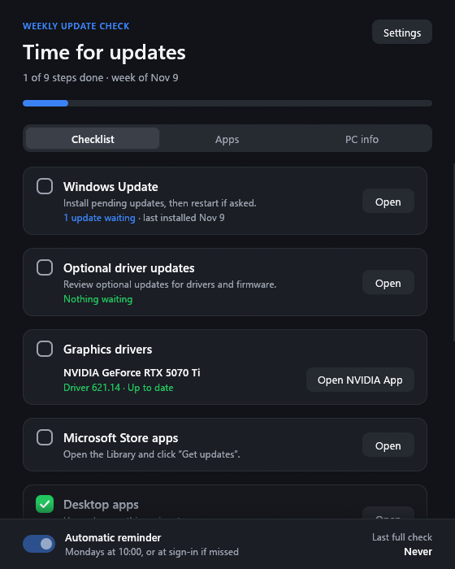

# Update Check

**Your weekly Windows update routine in one small app.** Update Check reminds you once a week and walks you
through everything a PC needs to stay up to date and secure: Windows Update, drivers, graphics drivers,
Store apps and desktop apps, virus protection, disk space and backups. It looks up what is actually waiting,
so you see at a glance which steps matter this week.

  

  Windows 10 and 11, 64-bit · free and open source · no installer, no account, no admin rights 
  <a href="https://github.com/Zorakidd/UpdateCheck/releases/latest">What's new</a> ·
  <a href="https://github.com/Zorakidd/UpdateCheck/releases">All versions</a>

  

## What it does

- **A checklist for the week.** Tick off each step as you go. **Open** takes you straight to the right
  settings page or app. The list starts fresh every week on the day you choose.
- **Shows what's waiting.** Windows Update, optional driver updates and your desktop apps say how many
  updates are queued, for example "2 upgrades waiting", and each step ticks itself off when there are none.
- **Graphics drivers.** Lists your NVIDIA, AMD or Intel graphics with the installed driver, tells you when
  NVIDIA has a newer one, and opens NVIDIA App, AMD Software or Intel Graphics Software for you.
- **Removes apps you never use.** Preinstalled apps such as Solitaire, the MSN apps or Clipchamp, removed
  for your account in one go. Apps you want to keep, you set aside with **Ignore**.
- **Knows your PC.** Maker and model, processor, memory, graphics, drives, Windows version, BIOS, Secure
  Boot and TPM, ready to copy for a support chat or a parts shop, plus everything plugged in.
- **Fixes Windows.** Checks and repairs Windows' system files, and resets USB sticks and memory cards that
  act up.
- **Stays out of your way.** It reminds you only while this week's list is unfinished, at most once a day,
  and never while a game or a presentation fills the screen.
- **Keeps itself up to date** with the releases published here, each checked before it is installed.

## Get started

1. **[Download UpdateCheck.exe](https://github.com/Zorakidd/UpdateCheck/releases/latest/download/UpdateCheck.exe)**
   (about 12 MB). If your browser asks whether to keep the file, choose **Keep**.
2. **Move it to a folder where it can stay,** such as Documents or `%LOCALAPPDATA%\Programs\Update Check`.
   Not Program Files: the app replaces its own .exe when it updates itself, which it can't do there.
3. **Start it.** The app isn't signed with a paid certificate, so Windows may say *Windows protected your
   PC* the first time. Click **More info**, then **Run anyway**.
4. **Say yes to the weekly reminder,** and Update Check starts with Windows and comes back each week at the
   time you set. You can change the day and time, and switch the reminder off, at any time.

## Using it

### Checklist

- Click anywhere on a step to tick it off. The header counts the weeks you finished in a row, and each step
  says when you last did it if it has been a while.
- **Settings** has the reminder day and time, light and dark mode, and lets you add, remove and reorder
  steps. A removed step comes back with **Undo** or Ctrl+Z.
- The Windows Update step also says when Windows last installed updates, and stays open while Windows waits
  for a restart to finish installing them. Driver updates include firmware, which on many brand PCs means
  the BIOS. If Windows gives no clear answer, a step says nothing rather than guess.
- **Free up space** says how much room is left on the drive Windows is on, and stands out below 20 GB, about
  what Windows needs to install a new version of itself.
- The counts are looked up again when you come back to the window after installing something.

### Apps

- The **Apps** tab lists the apps that came with Windows or the PC and that hardly anyone uses, the ones
  worth removing first. **Select recommended** ticks those, **Select all** every app on the tab. Calculator,
  Photos, Notepad and everything Windows needs are never offered.
- **Remove selected** asks first, then removes the ticked apps for your account only. The Microsoft Store
  has every one of them if you want one back.
- **Resume**, which continues on the PC what you had open on your phone, is part of Windows and can't be
  removed. Ticking it turns it off for everyone on the PC, which takes administrator rights, so
  `CrossDeviceResume.exe` no longer runs in the background. **Turn on** at the end of the tab brings it back.
- Microsoft Edge (where Windows allows it, in the European Economic Area), OneDrive and trial software can only be removed in Windows'
  Settings, so the tab tells you step by step how.
- **Ignore** keeps an app: it is no longer offered or counted, and is listed at the end of the tab with
  **Show again**.

### PC info

- **Show details** adds each memory module's maker, part number and speed, the processor's cores and
  caches, the graphics memory and every drive with its volumes. **Copy to clipboard** puts it all in plain
  text.
- *Is the BIOS up to date?* Nothing on the PC can tell, so the tab shows how old the BIOS is. **Find BIOS
  updates** opens Dell's, HP's or Lenovo's support site, which finds your PC's downloads by itself, Windows
  Update on a Surface, or else a web search for your model's BIOS.
- **Show connected devices** lists displays, keyboards and mice, audio, cameras, controllers, drives,
  phones and printers, says whether each is connected by USB or Bluetooth and points out a missing driver.

### When Windows misbehaves

These tools are at the end of **Settings**. They ask for administrator rights.

- **Check system files** runs System File Checker (`sfc /scannow`). **Repair Windows** first repairs
  Windows' own copy of its files with DISM, then checks the system files.
- **Reset a USB drive** erases a USB stick or memory card and sets it up as one empty drive, for when it
  shows the wrong size, won't format or still holds an old Windows installer. Since erasing can't be undone,
  only USB drives and memory cards are offered, you see what is on the drive first, and you type `ERASE` to
  confirm.

### Updates

Once a day Update Check looks for a new version here and installs it by itself, then restarts. Before it
does, it checks the download against the SHA-256 fingerprint GitHub publishes for it, and doesn't install a
download that doesn't match. **Settings** shows the version you have, and **Check now** looks right away.

### Keyboard

Tab moves between controls, Space or Enter presses one, Page Up, Page Down, Home and End scroll, Escape goes
back, and Ctrl+Z undoes removing a step.

## Privacy

- No account, no ads, no telemetry.
- The app itself contacts only GitHub, at most once a day to look for its own updates, and NVIDIA's driver
  search if your PC has NVIDIA graphics. winget and Windows Update reach their own servers as usual.
- Your checklist and the logs stay on your PC, in the folder `UpdateCheck` in your Downloads folder.

## Uninstall

Turn off the **Automatic reminder** switch at the bottom of the window, which removes Update Check from
Windows startup. Then delete `UpdateCheck.exe` and the folder `UpdateCheck` in your Downloads folder.

## For IT

- **Policy.** Set the DWORD `DisableSelfUpdate` to `1` under `HKLM\SOFTWARE\Policies\UpdateCheck`, by Group
  Policy Preferences, an Intune script or any other way of setting a registry value, to roll out new
  versions yourself. The app then never contacts GitHub, and Settings says that your organization keeps it
  up to date.
- **Rights.** Nothing needs administrator rights except Check system files, Repair Windows, Reset a USB
  drive and turning Resume off or on, which ask through UAC. The reminder is a per-user sign-in entry (`HKCU\...\Run`) and a per-user
  Task Scheduler task, `UpdateCheck (<user name>)`, both running `UpdateCheck.exe --check`, so several users
  on one PC each have their own. They are re-registered if the .exe moves. Apps are only ever removed for
  the signed-in user. Turning off Resume sets the local default of the policy
  `Connectivity/DisableCrossDeviceResume` (`HKLM\SOFTWARE\Microsoft\PolicyManager\default\Connectivity\DisableCrossDeviceResume`,
  `value`) with `reg.exe`; where an MDM sets the policy, the tab doesn't offer Resume.
- **Network.** Requests go through WinHTTP with the PC's proxy settings and Windows' certificate store.
- **Updates.** Each release is built from this repository's code by GitHub Actions. The app installs a new
  version only after checking it against the SHA-256 digest GitHub publishes for the download.
- **Files.** `UpdateCheck` in the user's Downloads folder (the known folder, wherever it was moved) holds
  `state.json` (the checklist), `update-check.log` (warnings and errors) and `removed-apps.log` (what the
  Apps tab removed). The logs are kept to about 1 MB and 256 KB, with the previous log beside each as
  `.log.1`. Versions before this one used `%APPDATA%\UpdateCheck`; its contents move over on the first start.

## Build it yourself

See [DEVELOPMENT.md](DEVELOPMENT.md). Update Check is licensed under the [MIT License](LICENSE).
